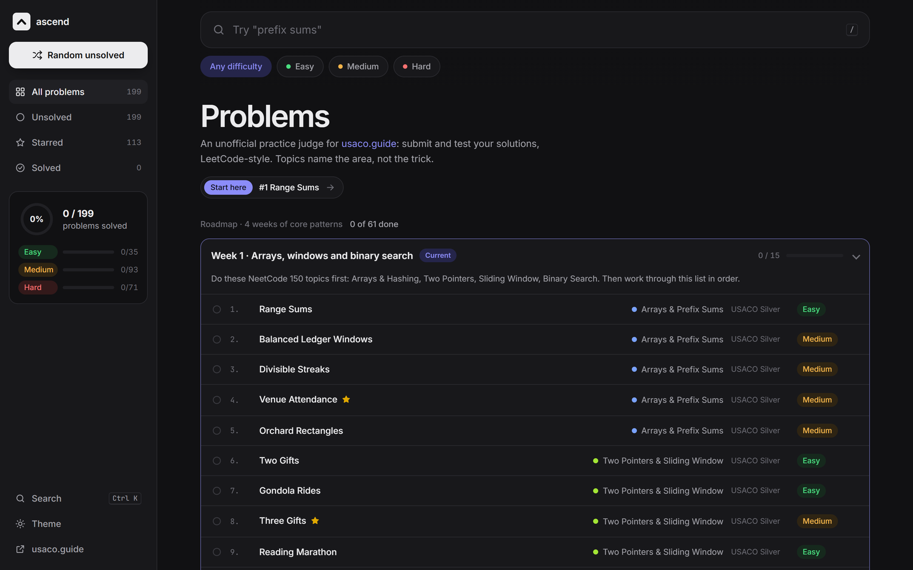

<p align="center">
  
</p>

<h1 align="center">Ascend</h1>

<p align="center">
  <strong>A local, LeetCode-style judge for the problems behind usaco.guide.</strong><br />
  199 interview-relevant problems, each with hidden tests that catch slow solutions.
</p>

<p align="center">
  <a href="https://usaco.guide">usaco.guide</a> ·
  <a href="plan.md">Problem list</a>
</p>

<p align="center">
  
  
  
  
</p>

<p align="center"><em>Personal project for SWE interview practice. Not affiliated with usaco.guide.</em></p>

<p align="center">
  
</p>

## Overview

- **Run** your `class Solution` on the examples, or **Submit** it against ~30 hidden tests, including large inputs (n ≈ 10⁵) where an O(n²) solution won't finish in the 2 s limit.
- **A four-week roadmap** of core patterns, plus search, difficulty filters, and a random unsolved pick.
- **Hints and references:** each problem has a hidden pattern hint, a link to its usaco.guide module, and a spoiler solution.
- **Progress travels with the repo:** solutions save to `solutions/<id>.py` and solved status to `progress.json`.

## How it works

1. Each problem in `problems.py` defines a reference solution, a slow brute force, a test generator, and examples.
2. `python problems.py` checks every reference solution against its brute force on random inputs.
3. `server.py` runs your code in a separate process with the usual LeetCode imports in scope and a time limit per test.

## Run it

Requires Python 3. No packages to install.

```bash
python server.py     # then open http://localhost:8000
python problems.py   # self-check every problem
```

**Adding a problem:** copy any class in `problems.py`, give it a `ref`, a `brute`, a `gen(rng, big)`, and `examples`, then run `python problems.py`.
